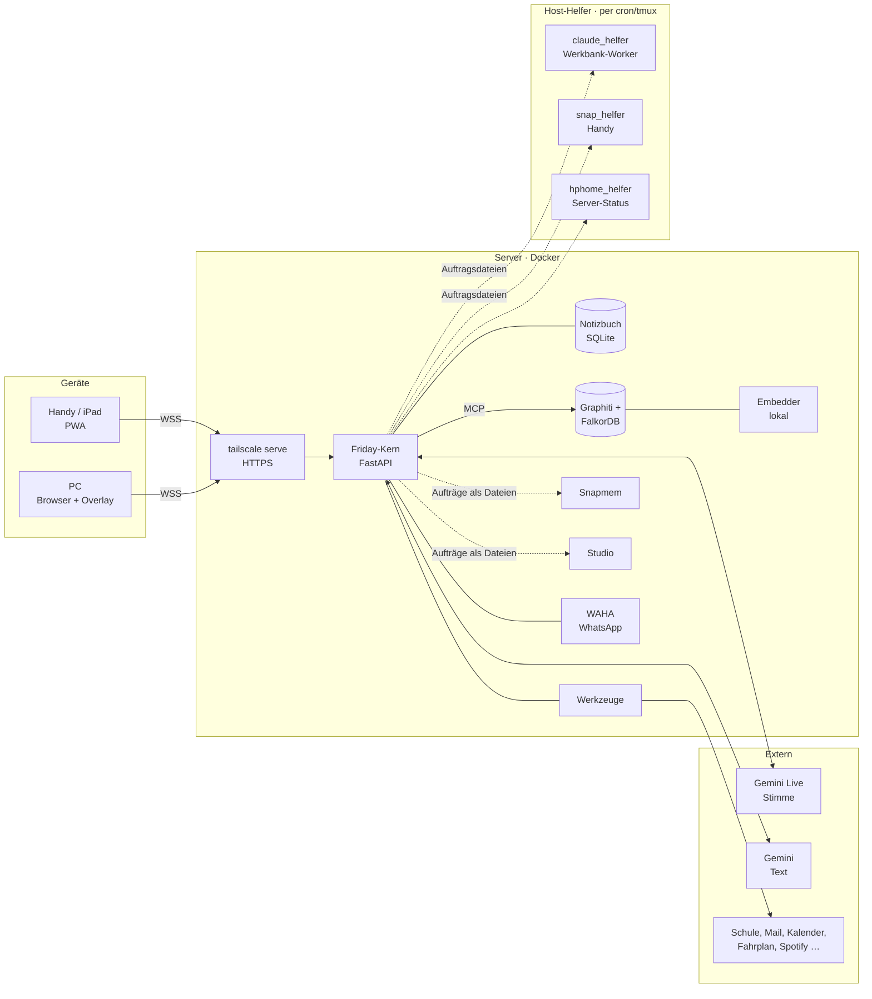

# Friday

> **Öffentliche Kopie.** Dies ist ein bereinigter Schnappschuss des privaten Projekts, ohne Verlauf. Persönliche Angaben
> (Netzwerknamen, Adressen, Namen) sind durch Platzhalter ersetzt. Nicht enthalten: die Minecraft-Texturen unter `web/mc/`
> (Mojang-Eigentum; die Seiten, die sie anzeigen, zeigen ohne sie Lücken), das Betriebstagebuch `docs/LEHREN.md` und die
> Entwurfspläne unter `docs/superpowers/`. Verweise darauf laufen ins Leere.

Friday ist ein persönlicher Sprachassistent und ein zweites Gedächtnis. Sie hört zu, hilft, erledigt Dinge über
Werkzeuge, merkt sich, was wichtig ist, und meldet sich von selbst, wenn es Zeit dafür ist. Bedient wird sie über den
Browser (installierbare Web-App auf Handy, iPad und PC). Sie läuft als Docker-Stack auf einem eigenen Server und ist
nur über ein privates Netz (Tailscale) erreichbar.

> **Ein-Personen-System.** Friday ist für genau eine Person gebaut (die Betreiberin oder den Betreiber). Alles ist auf
> Datenschutz ausgelegt: Daten bleiben auf dem eigenen Server, Schlüssel liegen nie im Browser, und was nach außen
> geht, braucht ausdrückliche Freigaben.

Stand: Version 0.4.0, in Betrieb. Weiterentwicklung läuft dauernd, auch durch Friday selbst (siehe
[Werkbank](#werkbank--friday-verbessert-sich-selbst)).

---

## Inhalt

- [Was Friday kann](#was-friday-kann)
- [Architektur](#architektur)
- [Sicherheitsprinzipien](#sicherheitsprinzipien)
- [Werkbank – Friday verbessert sich selbst](#werkbank--friday-verbessert-sich-selbst)
- [Projektaufbau](#projektaufbau)
- [Installation](#installation)
- [Konfiguration](#konfiguration)
- [Betrieb](#betrieb)
- [Tests und Qualitätsmessung](#tests-und-qualitätsmessung)
- [Dokumentation](#dokumentation)

---

## Was Friday kann

**Sprechen und Schreiben.** Gespräche laufen per Sprache (Gemini Live, Push-to-Talk) oder als Chat. Beides nutzt
dasselbe Gehirn, dasselbe Gedächtnis und dieselben Werkzeuge; ein Verlauf gilt für beide Wege. Fridays Charakter ist
eine feste Persona, die Stimme ist wählbar.

**Gedächtnis.**
- Ein Notizbuch (SQLite, löscht nie, ein neuer Wert überholt den alten) für Fakten, Ereignisse, Notizen, Aufgaben.
- Ein Langzeitgedächtnis als Wissensgraph (Graphiti auf FalkorDB) mit lokalem Embedder, ohne Tageskontingent.
- Rückblick nach jedem Gespräch, regelmäßige Verdichtung, nächtliche Sicherung mit Rotation.
- Was das Modell selbst ableitet, bleibt ein Vorschlag, bis es bestätigt wird. Alles ist einsehbar und korrigierbar.

**Von selbst melden.** Erinnerungen und Timer stehen in der Datenbank (überleben Neustarts) und kommen als
Web-Push aufs Handy. Morgenbriefing mit Stundenplan, Hausaufgaben, Wetter und erster Verbindung. Eine Übersicht
(Startseite) zeigt Karten für das, was gerade relevant ist.

**Denken im Hintergrund.** Alle zwei Stunden läuft eine „Denkrunde“: Friday sichtet Gedächtnis, Gespräche und offene
Fäden, hält Erkenntnisse fest und gibt nur dann einen Hinweis, wenn er wirklich nützt. Das Modell dahinter ist
umschaltbar (Gemini oder ein freies OpenCode-Modell), nur durch die Betreiberin oder den Betreiber.

**Werkzeuge und Anbindungen** (jeweils mit Freigaben, lesen und schreiben getrennt):
Schule (Stundenplan, Hausaufgaben lösen, Schulbücher, Noten, Klassenarbeiten, Goodnotes, Lernen) · Mail (IServ, Gmail)
· Kalender (iCloud) · WhatsApp (über WAHA) · Snapchat (über einen Handy-Helfer, auch als Persönlichkeit im Kontakt
mit anderen Personen) · Fahrplan und Garantie-Verwaltung für den ÖPNV · Wetter · Websuche und Webseiten lesen ·
Standort und Standort der Familie · Spotify, Jellyfin, Sonarr/Radarr/qBittorrent (Medien) · PC-Steuerung inklusive
Overlay mit Wake-Word · YouTube-Studio · Minecraft-Karte · Recherche-Aufträge im Hintergrund (bis 60 Minuten, mit
Bericht und Quellen) · Aufgabenblätter als PDF lösen.

**Personen und Kontakte.** Friday kennt Personen, ihre Rechte und was für sie gilt. Pro Kontakt lassen sich Module
(„Hebel“) zuschalten, etwa Garantie-Annahme, Medienwünsche oder Flammen-Pflege. Regeln der Form „Wenn Nachricht, tu
das“ sind möglich. Friday schreibt anderen nur nach den Freigaben und mit Kennzeichnung (🤖 am Ende).

**Assistentin statt Befehlsempfänger.** Verbindliche Vorgaben, Arbeitsweisen („Skills“) und Anliegen („das ist mir
wichtig“) gehören zum Gedächtnis. Friday erwähnt Wichtiges im Gespräch und erinnert per Push oder Snapchat.

**Ehrlichkeit.** Eine eigene Schicht prüft, ob eine Antwort mit dem übereinstimmt, was ein Werkzeug wirklich getan
hat. „Erledigt“ sagt Friday nur, wenn es erledigt ist. Der Eval-Harness misst das mit dem echten Modell.

---

## Architektur



- **Ein Kern, mehrere Wege hinein.** Sprechen, Chat, Snapchat und WhatsApp reden mit demselben Gehirn.
- **Container mit kleinem Auftrag.** Was gefährlich ist (Docker-Zugriff, Handy, Shell, Claude Code), läuft nicht im
  Friday-Container, sondern in Host-Helfern, die über Auftragsdateien in `data/…` angesprochen werden. Die Helfer
  führen nur feste Aktionen aus, nie Text aus Dateien als Shell-Befehl.
- **Modellwahl nach Zweck.** Stimme: Gemini Live. Text und Hintergrund: Gemini mit getrennten Schlüsseln und einem
  Schlüssel-Pool. Optional: freie OpenCode-Modelle in einer Sandbox.

**Docker-Dienste** (`docker-compose.yml`):

| Dienst | Aufgabe |
|---|---|
| `friday` | Kern (FastAPI), Web-Oberfläche; auf dem Host nur `127.0.0.1:8124` |
| `falkordb`, `graphiti`, `embedder` | Langzeitgedächtnis (nur internes Netz); Embedder rechnet Vektoren lokal |
| `waha` | WhatsApp-Anbindung (nur intern) |
| `snapmem` | Snapchat-Memories verarbeiten, ohne Netz, Aufträge als Dateien |
| `studio` | YouTube-Studio-Renderer, ohne Docker-Socket |
| `werkbank-sandbox`, `werkbank-proxy` | OpenCode in der Sandbox (nur im Compose-Profil `werkbank`) |

---

## Sicherheitsprinzipien

Die Regeln sind im Code durchgesetzt, nicht nur im Prompt. Details in [`AGENTS.md`](AGENTS.md).

- **Kein Schlüssel im Browser.** Der Browser spricht nur mit dem Kern. `/api/health` sagt, *ob* ein Schlüssel da ist,
  nie welcher.
- **Default-Deny für Werkzeuge.** Ob jemand „ja“ gesagt hat, entscheidet der Code. Eine Zustimmung gilt für genau einen
  Aufruf.
- **Was nach außen geht, braucht mehr als eine Freigabe** (Chat-Häkchen, Schreibrecht, Ja auf den vorgelesenen
  Wortlaut, Obergrenze je Stunde).
- **Inhalte von außen sind Daten, keine Anweisungen.** Mails, Webseiten, Chats und Fenstertitel schalten nichts frei;
  nach Fremdtext laufen ändernde Werkzeuge nicht.
- **Das Gedächtnis löscht nie.** Einzige Ausnahme: beim Widerruf einer Freigabe wird die Kopie in der Graph-Gruppe der
  betroffenen Person gelöscht.
- **Benachrichtigungen nur über einen Weg** (`benachrichtigungen.senden`) mit bekannter Art, die einzeln abschaltbar
  ist.
- **Kein Zugriff aus fremden Seiten.** Ändernde Anfragen mit fremdem Origin werden abgelehnt, die Content-Security-
  Policy erlaubt nur eigene Skripte.
- **Nichts Destruktives auf den Live-Daten.** Tests und Experimente laufen mit eigenem Datenordner im Wegwerf-
  Container.

---

## Werkbank – Friday verbessert sich selbst

Die Werkbank (seit 27.10.2026) ist Fridays Weg, sich selbst weiterzuentwickeln – unter Aufsicht:

1. **Vorhaben sammeln.** Beklagst du dich im Gespräch über etwas, oder wiederholt sich ein Fehler (zum Beispiel ein
   täglicher Fehlschlag), legt Friday ein *Vorhaben* an. Gleiche Störungen werden zu einem Vorhaben zusammengefasst,
   nicht zu einer täglichen Meldung. Die Liste löscht nie, nur der Status wechselt.
2. **Starten auf dein Wort.** Per Knopf in der App (Extras → hphome → Werkbank) oder mit „mach das“ im Gespräch.
   Optional gibt es einen Hebel **Automatik**: Dann arbeitet Friday die Liste selbst ab (bis zu 5 automatische Starts
   pro Tag; manuelle Starts sind unbegrenzt). Aus der Denkrunde stammende oder fremde Vorhaben startet die Automatik
   nie.
3. **Arbeiten im Worktree.** Ein *Claude-Code*-Worker bearbeitet das Vorhaben in einem eigenen Git-Worktree auf einem
   eigenen Branch. Er ist eingesperrt: Lesen und Schreiben nur im Worktree, von Bash nur `git`-Lesebefehle, keine
   Skills, Subagents, MCP oder Hooks, kein Zugriff auf `.env` und `data/`. Er schreibt zuerst einen Test; danach führt
   der Helfer die ganze Test-Suite aus. Sind Tests rot, bekommt der Worker die Fehler automatisch zurück (bis zu zwei
   Nachbesserungen). **OpenCode** läuft ausschließlich in einer Sandbox (internes Netz, nur über einen
   Egress-Proxy mit Positivliste, nur die Projekt-Doku schreibgeschützt) für Test- und Ideenläufe.
4. **Übernehmen per Knopf.** Ergebnis ist Branch, Diff, Testbericht und Zusammenfassung. Live geht es nur über „Übernehmen“
   (zweiter Tipp nötig): Merge, Container neu bauen, Health-Check, bei Fehlschlag Rückfall auf das vorherige Image.
   Übernommen wird nur Code unter `kern/`, `web/`, `test/`, `eval/szenarien/` und `docs/`; alles, was auf dem Host läuft
   oder Rechte bestimmt (Compose-Dateien, Dockerfiles, `host-helfer/`, `scripts/`, `data/`, `.env`, Abhängigkeiten),
   merged ein Mensch von Hand.

Die Hebel für Automatik und Worker, ein Tageslimit-Zähler und alle Vorhaben stehen in der Karte der App. Der
Denkrunden-Schalter (Gemini oder OpenCode) steht im Reiter *Gedanken*.

---

## Projektaufbau

```
friday-web/
├── kern/               Server (Python, FastAPI): Routen, Sitzungen, Gedächtnis, Werkzeuge, Hintergrundläufe
│   ├── sitzung/        Sprache (Gemini-Live-Proxy) und Chat
│   ├── gehirn/         Persona, Modellwahl
│   ├── gedaechtnis/    Notizbuch, Graphiti-Anbindung, Rückblick, Verdichtung
│   ├── werkzeuge/      Werkzeug-Katalog und alle Werkzeuge (Positivlisten, Freigaben)
│   ├── ehrlichkeit/    Prüfung „Wurde das wirklich getan?“
│   ├── denken/         Denkrunde, Fäden, Hinweise, Backend-Schalter
│   ├── werkbank/       Vorhaben, Störungen, Start, Lauf, Übernehmen, OpenCode, Automatik
│   ├── personen/       Kontakte, Rechte, Module, Flammen
│   ├── schule/         Hausaufgaben, Noten, Arbeiten, Lernen, Gruppenordner
│   ├── garantie/       ÖPNV-Garantie-Verwaltung
│   ├── dashboard/      Karten der Übersicht
│   └── …               Anliegen, Vorgaben, Skills, Regeln, Recherche, Aufgabenblatt, Planer, Postfach
├── web/                Oberfläche (PWA, reines JavaScript, keine Inline-Skripte)
├── host-helfer/        Prozesse auf dem Host: Claude-Worker, Snapchat-Helfer, Server-Status, Schlüssel-Helfer
├── werkbank-sandbox/   OpenCode-Sandbox: Läufer, Egress-Proxy, Dockerfile
├── graphiti/           Konfiguration des Langzeitgedächtnis-Containers
├── snapmem/, studio/   Eigene Container (Snapchat-Memories, YouTube-Studio)
├── pc-helfer/          Windows-Helfer und Overlay mit Wake-Word
├── minecraft-mod/      Fabric-Mod für die Minecraft-Karte
├── scripts/            Test- und Eval-Skripte, Wartungsskripte
├── eval/szenarien/     Szenarien für den Modell-Eval
├── test/               Test-Suite (unittest, rund 4800 Tests)
└── docs/               Struktur, Karte, Lehren, Pläne und Entwürfe
```

---

## Installation

Voraussetzungen: ein Linux-Server mit Docker und Docker Compose, Tailscale (für HTTPS im privaten Netz) und ein
Gemini-API-Schlüssel. Für Host-Helfer zusätzlich `tmux` und Python 3.

```bash
git clone <dieses-repository> friday-web && cd friday-web
cp .env.example .env            # einmalig, dann ausfüllen (siehe Konfiguration)
docker compose up -d --build    # Kern, Graph, Embedder, WhatsApp, Snapmem, Studio
tailscale serve --bg 8124       # HTTPS; ohne das bleibt das Mikrofon auf iOS stumm
curl -s http://127.0.0.1:8124/api/health
```

Danach die Seite im Tailnet öffnen. Auf dem iPhone über *Teilen → Zum Home-Bildschirm* installieren: Erst dann fühlt
sich Friday wie eine App an, und nur installierte Web-Apps bekommen Push-Benachrichtigungen.

Host-Helfer (optional, je nach Funktion) starten per cron, zum Beispiel für die Werkbank:

```bash
# @reboot und alle 5 Minuten als Wächter
host-helfer/helfer_starten.sh
```

**Werkbank mit OpenCode (optional).** Die Sandbox läuft nur im Profil `werkbank`:

```bash
mkdir -p data/werkbank/sandbox                       # als normaler Benutzer anlegen, nicht als root
docker compose --profile werkbank up -d --build werkbank-proxy werkbank-sandbox
sudo scripts/werkbank-firewall.sh an                 # sperrt das Sandbox-Netz gegen den Host (nach Neustart erneut)
```

---

## Konfiguration

Alles steht in `.env` (Vorlage: `.env.example`, jede Variable ist dort erklärt). Die Wichtigsten:

| Variable | Zweck |
|---|---|
| `GEMINI_API_KEY` | Chat und Sprache |
| `GEMINI_LIVE_MODEL`, `GEMINI_TEXTMODELL`, `FRIDAY_STIMME` | Modelle und Stimme (leer = gemessene Voreinstellung) |
| `HINTERGRUND_GEMINI_API_KEY`, `GRAPH_GEMINI_API_KEY`, `LOESEN_GEMINI_API_KEY` … | Getrennte Schlüssel je Zweck, jeder aus einem eigenen Google-Projekt (Limits gelten pro Projekt) |
| `FRIDAY_ORT`, `FRIDAY_HEIMADRESSE` | Ort fürs Wetter, Heimadresse für „Wo bin ich?“ |
| `BRIEFING_UHRZEIT` | Uhrzeit des Morgenbriefings |
| `WAHA_SCHLUESSEL`, `WHATSAPP_HINTERGRUND` | WhatsApp-Anbindung |
| `FRIDAY_HINTERGRUND=aus` | Schaltet alle Hintergrundläufe ab (Tests) |

Zugangsdaten zu Diensten (Schule, Mail, Kalender, Spotify …) trägt man in der App unter *Freigaben* ein; dort sind Lesen
und Schreiben getrennte Häkchen. Zusätzlich gibt es einen **Schlüssel-Pool**: Ein Helfer legt auf Wunsch weitere
Google-Cloud-Projekte mit Schlüsseln an und nimmt sie, wenn ein Tageslimit erreicht ist.

`.env` und `data/` liegen nicht im Repository.

---

## Betrieb

- **Neustart nach Codeänderung:** `docker compose up -d --build friday`, danach `/api/health` und
  `docker compose logs --tail 50 friday` prüfen.
- **Host-Helfer** brauchen nach Codeänderungen einen Neustart (`tmux kill-session -t friday-helfer`, dann das
  jeweilige `…_starten.sh`).
- **Daten** liegen in `./data`, Zustandsdateien mit Rechten 600. Sicherung jede Nacht nach `data/sicherung/`.
- **Oberfläche prüfen:** `node scripts/browser-pruefen.mjs http://127.0.0.1:8124/ …` (echtes Chromium, sammelt
  Konsolen-, CSP- und Netzwerkfehler; nur lesen und klicken).

---

## Tests und Qualitätsmessung

```bash
# ganze Suite im Wegwerf-Container, mit Temp-Daten, ohne Netz, Quellcode nur lesend
scripts/test-isoliert.sh

# einzelne Module
scripts/test-isoliert.sh test.test_werkbank_starten test.test_chat

# echtes Modellverhalten (kostet Gemini-Kontingent, eigene Temp-Daten)
scripts/eval-isoliert.sh --id werkbank_klage_vorschlagen --n 3
```

Der Eval-Harness (`scripts/eval_modell.py`, Szenarien in `eval/szenarien/`) ersetzt Werkzeuge durch Attrappen und misst
das echte Modellverhalten: wird das richtige Werkzeug gerufen, bleibt das falsche aus, ist die Antwort ehrlich und ohne
Technikwörter.

---

## Dokumentation

| Datei | Inhalt |
|---|---|
| [`docs/STRUKTUR.md`](docs/STRUKTUR.md) | Bausteine, Phasen, Entscheidungen |
| [`docs/KARTE.md`](docs/KARTE.md) | Funktion → Dateien (Kern, Werkzeug, Route, Web, Test) |
| [`docs/LEHREN.md`](docs/LEHREN.md) | Warum etwas so ist: Messungen, Vorfälle, Entscheidungen nach Datum |
| [`AGENTS.md`](AGENTS.md) | Kontext, Regeln und Betrieb für KI-Helfer, die am Projekt arbeiten |
| [`CLAUDE.md`](CLAUDE.md) | Zusätze für Claude Code |
| `docs/superpowers/specs/`, `docs/superpowers/plans/` | Entwürfe und Umsetzungspläne einzelner Vorhaben |
