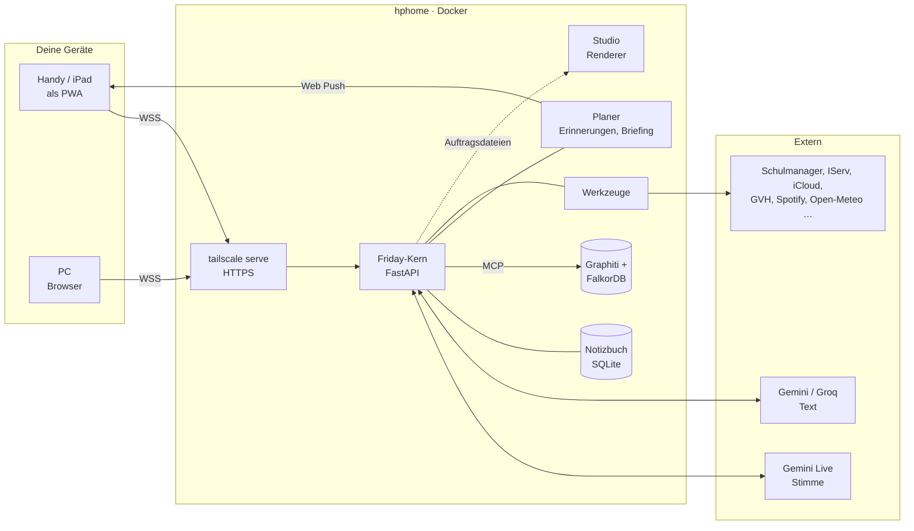

# Friday — Struktur

Stand: 14.09.2026 · Status: **beschlossen am 11.09.2026, seitdem ausgebaut** —
Entscheidungen stehen am Ende, der Umsetzungsstand bei den Phasen. Die Gründe
hinter späteren Entscheidungen: `docs/LEHREN.md`.

Friday ist ein Sprachassistent, der

1. **hilft** — Fragen beantworten, Überblick geben, mitdenken,
2. **Dinge erledigt** — über Werkzeuge, mit Freigabe,
3. **ein zweites Gedächtnis ist** — merkt sich, findet wieder, erinnert von selbst.

Bedient wird Friday über den Browser: Handy, iPad, PC. Er läuft auf `hphome`
und ist aus dem Tailnet erreichbar.

---

## Leitlinien

- **Übernehmen statt nachbauen.** Das alte Friday (Windows) und `seminar-ki`
  sind Nachschlagewerk und Steinbruch, keine Vorlage zum Abschreiben.
  Standards und fertige Dienste gehen vor Eigenbau.
- **Ein Kern, mehrere Wege hinein.** Sprechen und Schreiben reden mit
  demselben Gehirn, demselben Gedächtnis und denselben Werkzeugen.
- **Sicherheit vor Bequemlichkeit.** Default-Deny. Ob du „ja" gesagt hast,
  entscheidet der Code, nicht das Modell.
- **Das Gedächtnis gehört dir.** Einsehbar, korrigierbar, nichts wird still
  gelöscht, alles wird gesichert.
- **Klein anfangen.** Jede Phase endet mit etwas, das man benutzen kann.

---

## Überblick



---

## Die sechs Bausteine

### 1 · Oberfläche — Browser als PWA

- **Installierbar auf dem Home-Bildschirm.** Fühlt sich an wie eine App, und
  iOS stellt Web-Push-Benachrichtigungen nur installierten Web-Apps zu.
  Ohne das kann Friday dich nie von sich aus erreichen (siehe Planer).
- **Seiten:** Sprechen · Chat · Gedächtnis · Freigaben · Protokoll · Einstellungen.
- **Audio wie in `seminar-ki`:** AudioWorklet mit 16 kHz hinein, 24 kHz
  heraus, Push-to-Talk mit ausdrücklichem `audioStreamEnd`.
- **Kein Schlüssel im Browser.** Der Browser spricht nur mit dem Kern.

### 2 · Friday-Kern — Server

Ein FastAPI-Prozess mit klar getrennten Teilen:

| Teil | Aufgabe |
|---|---|
| `sitzung/` | WebSocket-Sitzungen für Sprache (Gemini-Live-Proxy) und Text. Wiederaufbau nach Abbruch, Sitzungsfortsetzung über die ~15-Minuten-Grenze hinaus. |
| `gehirn/` | Modellwahl nach Zweck: Stimme → Gemini Live, Text und Hintergrund → Gemini, Schnelles → Groq. Die Idee von `waehle()` aus dem alten Friday. |
| `persona/` | Fridays Charakter und Stimme (Callirrhoe). Der Prompt wird so gebaut, dass die wichtigste Regel **zuletzt** steht — gelernt in `seminar-ki`, wo sie aus der Mitte heraus unterging. |
| `werkzeuge/` | Werkzeug-Ausführung mit Freigaben und Rückfragen; lädt eigene Werkzeuge und MCP-Server. |
| `gedaechtnis/` | Siehe Baustein 3. |
| `planer/` | Siehe Baustein 4. |
| `protokoll/` | Was Friday wann getan hat, mit welchem Ergebnis. |

### 3 · Gedächtnis — das zweite Gehirn

Die drei Arten aus dem alten Friday, plus zwei neue:

| Art | Was | Beispiel |
|---|---|---|
| **Fakten** (semantisch) | was gilt — mit Gültigkeitszeitraum | „trinkt schwarzen Kaffee" |
| **Ereignisse** (episodisch) | was passiert ist | das Gespräch vom 11.09. |
| **Notizen** · *neu* | freie Texte, Ideen, Mitschriften | „Idee für die Seminararbeit …" |
| **Aufgaben & Erinnerungen** · *neu* | was noch ansteht, mit Termin | „Mathe S. 31 bis Montag" |
| **Abläufe** (prozedural) | wie Friday etwas tut | das Morgenbriefing |

Regeln, übernommen, weil sie sich bewährt haben:

- **Nichts wird gelöscht.** Ein neuer Wert überholt den alten (`gueltig_bis`).
  So bleibt beantwortbar, was am Dienstag galt.
- **SQLite im WAL-Modus**, Suche über FTS5 (Volltext). Anfangs kein
  Vektor-Index — für ein persönliches Gedächtnis reicht Volltext. Embeddings
  erst, wenn Dokumente dazukommen.
- **Vorschläge statt Fakten.** Was das Modell selbst ableitet, bleibt ein
  Vorschlag, bis du es bestätigst.

Neu:

- **Gesprächsrückblick.** Nach jedem Gespräch fasst ein Textmodell zusammen,
  was neu war: ein Ereignis plus Vorschläge für Fakten und Aufgaben. Das
  schließt die Lücke, die in der alten `AGENTS.md` als offen vermerkt ist.
- **Gedächtnis-Seite im Browser:** sehen, bestätigen, korrigieren, vergessen.
- **Sicherung jede Nacht**, mit Rotation. Das Gedächtnis ist das Wertvollste
  am ganzen System; alles andere lässt sich neu bauen.

### 4 · Planer — Friday meldet sich von selbst

- **Erinnerungen und Timer stehen in der Datenbank, nicht im Prozess.** Sie
  überleben Neustarts — Lehre aus `timer_stellen`, dessen Zustand mit dem
  Prozess starb.
- **Zustellung per Web Push aufs Handy.** Das löst Wunsch #2 aus dem alten
  Friday („Friday kann nicht von sich aus sprechen"), und zwar sauberer als
  eine Sprachschleife, die nur in Gesprächszügen denkt.
- **Routinen:** Morgenbriefing (Stundenplan, Hausaufgaben, Wetter, erste
  Verbindung), abends ein Blick auf morgen.
- **Später:** der Werkstatt- und Reparaturlauf alle 30 Minuten. Auf dem Server
  läuft er endlich durch; auf dem PC wurde er nachts ausgeschaltet.

### 5 · Werkzeuge und Anbindungen

Das Sicherheitsmodell bleibt, wie es im alten Friday (B-04) steht: Default-Deny,
Rückfrage im Moment, eine Zustimmung gilt für genau einen Aufruf und läuft ab,
Fenstertitel und Inhalte sind Daten und keine Anweisungen, nie endgültig
löschen, nie überschreiben.

Werkzeuge kommen aus zwei Quellen:

- **Eigene Werkzeuge** in Python, die sich selbst finden wie `tools/laden.py`.
  Automatisch gefunden heißt weiterhin nicht automatisch erlaubt.
- **MCP-Server.** MCP ist inzwischen der Standard, über den Modelle an
  Werkzeuge kommen. Fertige Server aus dem Netz nutzen, statt jede Anbindung
  selbst zu schreiben.

Erste Anbindungen, nach Nutzen sortiert:

| Anbindung | Weg | Herkunft |
|---|---|---|
| Uhrzeit, Rechnen, Timer | eigenes Werkzeug | trivial |
| Wetter | Open-Meteo, kein Schlüssel nötig | neu |
| Stundenplan, Hausaufgaben | Schulmanager über IServ-SSO | altes Friday, `dienste/schulmanager.py` — fast unverändert übernehmbar |
| IServ-Kalender, -Dateien | nur lesend | Mark-L, `actions/iserv.py` |
| ÖPNV (ÜSTRA / GVH) | | Mark-L |
| Websuche | | neu |
| Jellyfin | lokal auf `hphome` | neu, optional |
| Windows-PC steuern | kleiner Helfer auf dem PC | **später** — höchstes Risiko, siehe unten |

Ein Dienst, der übers Netz Rechner sperren oder herunterfahren darf, ist
genau die Fähigkeit, die man nicht nebenbei aufmacht. Deshalb ganz hinten.

### 6 · Betrieb

- **Docker-Stack** unter `~/docker/`, nach deiner Konvention.
- **HTTPS über `tailscale serve`.** Ohne HTTPS gibt iOS Safari das Mikrofon
  nicht frei.
- **Schlüssel in `.env`:** Gemini, dazu die IServ-Zugangsdaten. Das
  IServ-Passwort liegt damit auf dem Server, lesbar nur für deinen Benutzer.
- **Sprachmodell: `gemini-3.1-flash-live-preview`.** In meiner Messung vom
  09.09. dreimal 5 von 5 Gesprächszügen stabil. Nicht
  `native-audio-preview-12-2025` — das brach bei 1/5, 2/5, 1/5 ab.
- **Datenschutz:** Für Nutzer im EWR gelten die Datenbedingungen der bezahlten
  Gemini-Stufe auch für die kostenlose — keine Verwendung zum Training
  (Gemini API Terms, Stand 28.04.2026). Der Vorbehalt in der alten
  `AGENTS.md` ist für dich damit **überholt**. Das gilt **nicht**
  automatisch für Groq oder OpenRouter-`:free`-Modelle; dort bleibt er.

---

## Ordnerstruktur

```
friday-web/
├── kern/                 Server (Python, FastAPI)
│   ├── main.py           Routen, Start der Hintergrundläufe
│   ├── konnektoren.py    Freigaben und Zugangsdaten je Dienst
│   ├── erinnerungen.py   Erinnerungen und ihr Versand
│   ├── sitzung/          Sprache (Gemini Live) und Chat
│   ├── gehirn/           Persona
│   ├── gedaechtnis/      Notizbuch, Graphiti, Rückblick, Verdichtung, Bilder
│   ├── werkzeuge/        Ein Modul je Bereich, katalog.py filtert und führt aus
│   ├── dienste/          Schulmanager, IServ, iCloud, GVH, Spotify, Wetter, Push, Studio, Web
│   ├── planer/           Morgenbriefing
│   ├── schule/ postfach/ chats/   Ablagen und Verarbeitung von Briefen, Mails, WhatsApp
│   ├── studio/           Tagesplanung für den YouTube-Kanal
│   └── protokoll/        Gespräche, Grundlage für Rückblick und Graph
├── web/                  PWA: Seiten, Audio-Worklet, Manifest, Service Worker
├── studio/               Eigener Container: Renderer und Auftragsarbeiter
├── graphiti/             Start und Konfiguration des Graphiti-Containers
├── test/
├── docs/                 STRUKTUR.md (dieses), LEHREN.md (Gründe, nach Datum)
├── AGENTS.md             Kontext für KI-Helfer: was jetzt gilt
├── Dockerfile
├── docker-compose.yml
└── .env.example
```

Abweichend vom Beschluss: Modellwahl steckt in `config.py` statt in `gehirn/`,
Erinnerungen liegen in `kern/erinnerungen.py` statt in `planer/`, und eigene
Werkzeuge werden fest im Katalog eingetragen statt selbst gefunden — damit ein
neues Modul nie still sichtbar wird.

---

## Was woher kommt

| Quelle | Was | Wie |
|---|---|---|
| `seminar-ki` | Browser-Audio, Live-Proxy, Wiederaufbau, HTTPS-Aufbau, Modell-Lehre | Code als Startpunkt |
| altes Friday | Gedächtnismodell, Sicherheitsmodell, Werkzeug-Laden, Protokoll, Schulmanager, Persona | Konzepte übernehmen, einzelne Dateien portieren |
| Mark-L | IServ, ÖPNV | Konzepte, später |
| Netz | FastAPI, `google-genai`, MCP-Server, Open-Meteo | Bibliotheken und Dienste |

**Bewusst nicht als Grundlage: Open WebUI und Khoj.** Beide sind stark, beide
machen Sprache aber nur als Diktat plus Vorlesen — kein Sprache-zu-Sprache
wie Gemini Live, und genau das macht Friday aus. Ihr Gedächtnis ist zudem
einfacher als das zeitlich versionierte Modell aus dem alten Friday. Khoj
bleibt eine Option für die Dokumentensuche in Phase 5.

---

## Phasen

| Phase | Ergebnis | Benutzbar als | Stand 14.09.2026 |
|---|---|---|---|
| **0 · Gerüst** | Repo, Container, HTTPS, leere PWA | Seite lädt auf dem Handy | fertig |
| **1 · Stimme** | Sprechen und Chat mit Fridays Persona | Gesprächspartner | fertig |
| **2 · Gedächtnis** | merken, erinnern, vergessen; Gedächtnis-Seite; Rückblick | zweites Gedächtnis | fertig, dazu Graphiti als Langzeitgedächtnis |
| **3 · Werkzeuge** | Freigaben; Wetter, Schulmanager, Notizen | Hilfe im Alltag | fertig |
| **4 · Proaktiv** | Erinnerungen, Web Push, Morgenbriefing | meldet sich von selbst | fertig; offen: Abendblick auf morgen |
| **5 · Ausbau** | MCP, IServ, Dokumente, ÖPNV | erweitert | teils: IServ-Mail, iCloud, GVH, Spotify, Suche, WhatsApp; MCP nur für Graphiti |
| **6 · Selbstbau** | Werkstatt und Reparatur auf dem Server | wächst von selbst | offen |

Nicht im ursprünglichen Plan, auf Eikes Wunsch dazugekommen: **Studio** — Planung
und Rendering eines Kurzvideos pro Tag für den YouTube-Kanal Beispielkanal,
veröffentlicht nur nach Eikes Ja.

---

## Entscheidungen (11.09.2026)

| # | Frage | Entschieden |
|---|---|---|
| 1 | Grundlage | **Eigener Kern** (FastAPI + Gemini Live). Open WebUI und Khoj nicht als Basis. |
| 2 | Code | **Neues Repo** `nesreduel/friday-web`. Das alte Friday bleibt unverändert als Nachschlagewerk. |
| 3 | Schreibzugriff | Eigener Deploy-Key **mit** Schreibrecht, nur für das neue Repo. Der Nur-Lesen-Schlüssel fürs alte Repo bleibt getrennt. |
| 4 | Port 443 | **Friday.** `seminar-ki` ist gestoppt, der Ordner bleibt (`docker compose up -d` startet ihn wieder). |
| 5 | Gedächtnisquellen | Schule, IServ-Kalender, Dokumente, Alltag — **alle gewünscht, aber später** (ab Phase 3). Zu Beginn: Gespräche und Notizen. |

## Quellen

- Gemini API Terms (Stand 28.04.2026): https://ai.google.dev/gemini-api/terms
- Khoj: https://github.com/khoj-ai/khoj · Sprache: https://docs.khoj.dev/features/voice-chat/
- Open WebUI, Gedächtnis: https://docs.openwebui.com/features/chat-conversations/memory/
- Open WebUI, Werkzeuge: https://docs.openwebui.com/features/extensibility/plugin/tools/
- Pipecat vs. LiveKit: https://www.dograh.com/feeds/blog/pipecat-livekit-agents
- Gemini Live vs. GPT-Realtime: https://flowtivity.ai/blog/gemini-3-1-flash-live-vs-gpt-realtime-1-5-voice-agent-comparison-2026/
- Gedächtnis-Frameworks: https://atlan.com/know/best-ai-agent-memory-frameworks-2026/
- MCP mit Gemini: https://google-gemini.github.io/gemini-cli/docs/tools/mcp-server.html
